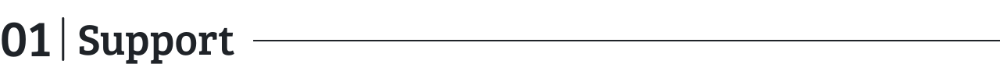
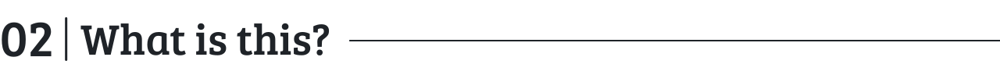
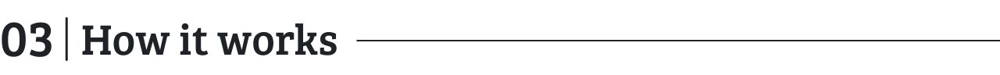
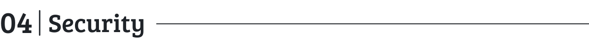
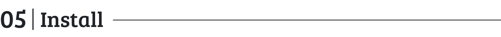
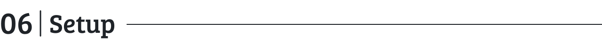
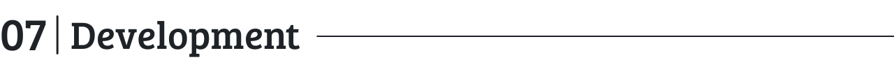
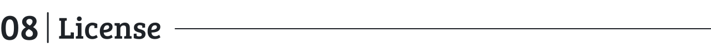
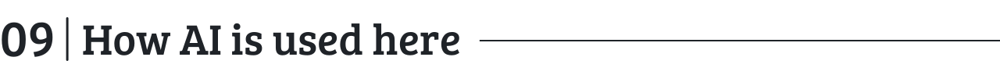

<p align="center">
  <picture>
    <source media="(prefers-color-scheme: dark)" srcset=".github/assets/tollroll-banner-dark.png">
    
  </picture>
</p>

<p align="center">
  <a href="https://github.com/junkerderprovinz/tollroll/actions/workflows/release.yml"></a>&nbsp;
  <a href="https://github.com/junkerderprovinz/tollroll/actions/workflows/lint.yml"></a>&nbsp;
  <a href="https://unraid.net"></a>&nbsp;
  <a href="LICENSE"></a>
</p>

<p align="center">
One tile on the Unraid dashboard for the apps of your fortress: a row per app that says how it is doing, and one log with the lines of all of them. Click an app and the log shows only its lines.<br>
It joins with the phrase of your fortress and keeps no phrase. The browser only ever talks to the Unraid WebGUI.
</p>

<br>

<p><a id="table-of-contents" href="#table-of-contents"><picture><source media="(prefers-color-scheme: dark)" srcset=".github/assets/sections/table-of-contents-dark.svg"></picture></a></p>

1. [Support](#1-support)
2. [What is this?](#2-what-is-this)
3. [How it works](#3-how-it-works)
4. [Security](#4-security)
5. [Install](#5-install)
6. [Setup](#6-setup)
7. [Development](#7-development)
8. [License](#8-license)
9. [How AI is used here](#9-how-ai-is-used-here)

<br>

<p><a id="1-support" href="#1-support"><picture><source media="(prefers-color-scheme: dark)" srcset=".github/assets/sections/1-support-dark.svg"></picture></a></p>

<p align="center">
A one-knight job: I build it, keep it running, work through the issues and add what people ask for, until nothing is missing. It is free, with no accounts, no telemetry, no ads and no paid tier. No asterisk anywhere. Nothing readable ever leaves your own walls. Forged on evenings and weekends, with heart and stubbornness.
</p>

<p align="center">
If it has earned a place on your server or computer, toss a coin to your knight: it helps cover the costs and keeps the project alive. It also makes this knight's heart beat a little faster. Three ways below, whichever suits you.
</p>

<p align="center">
  <a href="https://buymeacoffee.com/junkerderprovinz"></a>
  &nbsp;
  <a href="https://www.paypal.com/donate/?hosted_button_id=76FVV52TKXTUS"></a>
  &nbsp;
  <a href="https://junkerderprovinz.github.io/junkerderprovinz/"></a>
</p>

<br>

<p><a id="2-what-is-this" href="#2-what-is-this"><picture><source media="(prefers-color-scheme: dark)" srcset=".github/assets/sections/2-what-is-this-dark.svg"></picture></a></p>

An Unraid plugin that adds a dashboard tile named **TollRoll**. It shows up in Unraid's tile management like the built-in tiles, so you can hide it, move it or collapse it.

The tile reads every app in your fortress, the group of apps you joined with one phrase. Each app gets a row with its logo, its name, a dot and a short line, and its version. An app whose report carries no logo gets its first letter on a colour of its own. The line is the app's own words when it has something to say (what needs you, or what it is working on right now) and otherwise its state: running, starting, needs a look, overdue, failed or not reachable. An app that runs on two devices gets one row that says so and shows the worse of the two states.

Under the rows sits one log for all apps, newest at the bottom, in the dark terminal look it keeps on every Unraid theme. Click a row, or one of the buttons above the log, and the log shows only that app's lines. Once the filter names an app, the tile header gets a button that opens that app's web page.

The tile and the settings page speak the language you picked in Unraid, in all 26 languages Unraid offers. The texts that come from the apps arrive in that language too, as far as each app has them.

TollRoll can also tell you when something changes. Switch on Unraid's notifications, an Apprise URL or a Matrix room in the settings, and it sends a message when an app has not answered for a few minutes, when it answers again and when it shows something new that needs you. Each of these goes out once, not on every check. Pick **Only problems** to leave out the good news and the plain hints.

<br>

<p><a id="3-how-it-works" href="#3-how-it-works"><picture><source media="(prefers-color-scheme: dark)" srcset=".github/assets/sections/3-how-it-works-dark.svg"></picture></a></p>

The plugin has three parts.

- **A small service** (`tollroll`, written in Go) runs on the host. It listens on the unix socket `/var/run/tollroll.sock` and opens no network port. It is a member of your fortress, one that only reads: it offers nothing to the other apps and asks them to do nothing. When the tile asks, it reads every member side by side, its status report and its log, picking up the log where the last read stopped. It keeps the result for ten seconds, so several open dashboards do not multiply the traffic. While nobody is looking it reads nothing, unless a notification channel is on: then it checks every app once a minute.
- **A PHP proxy** (`server/api.php`) sits behind the Unraid login and passes a fixed list of calls to that socket. Nothing else in the plugin talks to the service.
- **The tile and the settings page** call the proxy from the browser. The tile asks again every 15 seconds while the dashboard is visible.

Apps come in one way only: through the fortress. Any app that joined with the same phrase shows up by itself, on this server or on another device. A member that reports no status, such as a plugin that joined only to read, stays off the tile.

<br>

<p><a id="4-security" href="#4-security"><picture><source media="(prefers-color-scheme: dark)" srcset=".github/assets/sections/4-security-dark.svg"></picture></a></p>

- **No open port.** The service listens only on its socket, which belongs to root. The browser reaches it through the WebGUI and its login. Every write is a POST, which Unraid checks for its CSRF token.
- **The phrase is never kept.** TollRoll turns the phrase into the keys of the fortress and its own member key and saves only those, in `/boot/config/plugins/tollroll/fortress`, readable by root alone. Neither the phrase nor any app's own key can be worked out from them. Whoever takes that folder is this one member at most, and any other member can remove it. After the phrase changes in one of your apps, enter the new one in TollRoll.
- **Notification secrets stay on the server.** The channels are saved in `/boot/config/plugins/tollroll/notify.json`, which only root can read. The settings page gets a Matrix token back masked, and a saved token goes only to the homeserver it was saved for.
- **A logo is a picture and nothing more.** An app's logo arrives in its status report as an SVG of at most 16 KiB. TollRoll drops one that holds a script, an event handler or a reference to anything outside it, and the tile shows a logo only as an image, where the browser runs no script anyway.
- **App data is text.** Everything an app sends is drawn as plain text, links open only for http and https addresses, and long names and lines are cut short.
- **Keep in mind:** the fortress keys live on the flash drive like every plugin's settings, so do not export the flash share publicly.

<br>

<p><a id="5-install" href="#5-install"><picture><source media="(prefers-color-scheme: dark)" srcset=".github/assets/sections/5-install-dark.svg"></picture></a></p>

**By URL:** Unraid → **Plugins** → **Install Plugin**, paste:

```
https://raw.githubusercontent.com/junkerderprovinz/tollroll/main/plugin/tollroll.plg
```

TollRoll needs Unraid 6.12 or newer.

<br>

<p><a id="6-setup" href="#6-setup"><picture><source media="(prefers-color-scheme: dark)" srcset=".github/assets/sections/6-setup-dark.svg"></picture></a></p>

1. Open **Instances** in any app of your fortress and copy its phrase, the twelve words.
2. In Unraid, open **Settings → Utilities → TollRoll**, paste the phrase and join. Every app of the fortress shows up by itself.
3. To get notified, fill in a channel under **Notifications**, try it with **Send a test message** and click **Apply**.
4. Open the **Dashboard**. The TollRoll tile sits in the middle column.

<br>

<p><a id="7-development" href="#7-development"><picture><source media="(prefers-color-scheme: dark)" srcset=".github/assets/sections/7-development-dark.svg"></picture></a></p>

```bash
go test ./...                       # the service
node --test plugin/test/*.test.js   # the tile's logic, the language files and the plugin files
bash plugin/pkg_build.sh 0.1.0      # builds plugin/out/tollroll-0.1.0-x86_64-1.txz
```

The plugin files live under [`plugin/src/tollroll/`](plugin/src/tollroll/) in the layout they have on the server. Releases are built by CI from a `v*` tag; it builds the package, publishes it and only then writes the new version and checksum into `plugin/tollroll.plg`.

<br>

<p><a id="8-license" href="#8-license"><picture><source media="(prefers-color-scheme: dark)" srcset=".github/assets/sections/8-license-dark.svg"></picture></a></p>

AGPL-3.0. See [LICENSE](LICENSE).

<br>

<p><a id="9-how-ai-is-used-here" href="#9-how-ai-is-used-here"><picture><source media="(prefers-color-scheme: dark)" srcset=".github/assets/sections/9-how-ai-is-used-here-dark.svg"></picture></a></p>

One knight builds this, and AI is one of the tools I work with, the same way I work with an editor or a compiler. It helps me write code and documentation and it checks my work, and that saves me a good many evenings. It does not make the decisions, though. I read and understand everything before it ships, and if something here breaks, that is on me and not on the tool.

You do not have to take my word for it. The code is open and every release note is written by hand. The issue tracker shows how problems actually get handled, including the ones I got wrong the first time. If you find something that is not right, open an issue and I will look at it.

<br>

Bugs, ideas or feature requests? Please [open a GitHub issue](https://github.com/junkerderprovinz/tollroll/issues).
