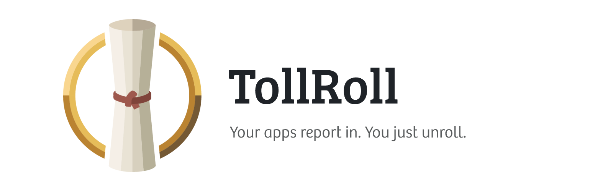
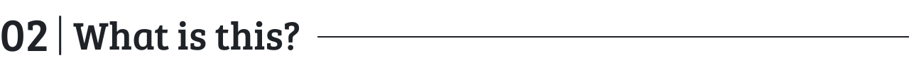
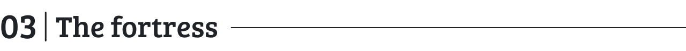
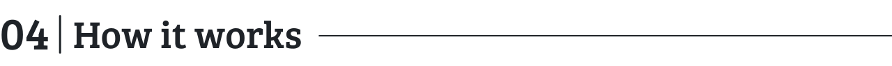
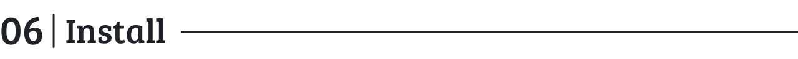
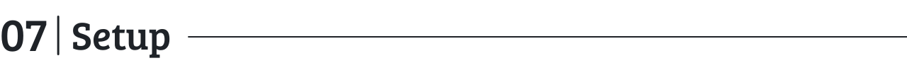
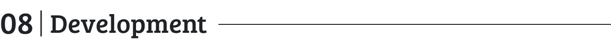
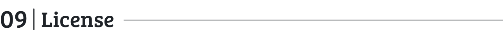

<p align="center">
  <picture>
    <source media="(prefers-color-scheme: dark)" srcset=".github/assets/tollroll-banner-dark.png">
    
  </picture>
</p>

<p align="center">
  <a href="https://github.com/junkerderprovinz/tollroll/actions/workflows/release.yml"></a>&nbsp;
  <a href="https://github.com/junkerderprovinz/tollroll/actions/workflows/lint.yml"></a>&nbsp;
  <a href="https://unraid.net"></a>&nbsp;
  <a href="LICENSE"></a>
</p>

<p align="center">
One tile on the Unraid dashboard for the apps of your fortress: a row per app that says how it is doing, and one log with the lines of all of them. Click an app and the log shows only its lines.<br>
It joins with the phrase of your fortress and keeps no phrase. The browser only ever talks to the Unraid WebGUI.
</p>

<br>

<p><a id="table-of-contents" href="#table-of-contents"><picture><source media="(prefers-color-scheme: dark)" srcset=".github/assets/sections/table-of-contents-dark.svg"></picture></a></p>

1. [Support](#1-support)
2. [What is this?](#2-what-is-this)
3. [The fortress](#3-the-fortress)
4. [How it works](#4-how-it-works)
5. [Security](#5-security)
6. [Install](#6-install)
7. [Setup](#7-setup)
8. [Development](#8-development)
9. [License](#9-license)
10. [How AI is used here](#10-how-ai-is-used-here)

<br>

<p><a id="1-support" href="#1-support"><picture><source media="(prefers-color-scheme: dark)" srcset=".github/assets/sections/1-support-dark.svg"></picture></a></p>

<p align="center">
A one-knight job: I build it, keep it running, work through the issues and add what people ask for, until nothing is missing. It is free, with no accounts, no telemetry, no ads and no paid tier. No asterisk anywhere. Nothing readable ever leaves your own walls. Forged on evenings and weekends, with heart and stubbornness.
</p>

<p align="center">
If it has earned a place on your server or computer, toss a coin to your knight: it helps cover the costs and keeps the project alive. It also makes this knight's heart beat a little faster. Three ways below, whichever suits you.
</p>

<p align="center">
  <a href="https://buymeacoffee.com/junkerderprovinz"></a>
  &nbsp;
  <a href="https://www.paypal.com/donate/?hosted_button_id=76FVV52TKXTUS"></a>
  &nbsp;
  <a href="https://junkerderprovinz.github.io/junkerderprovinz/"></a>
</p>

<br>

<p><a id="2-what-is-this" href="#2-what-is-this"><picture><source media="(prefers-color-scheme: dark)" srcset=".github/assets/sections/2-what-is-this-dark.svg"></picture></a></p>

An Unraid plugin that adds a dashboard tile named **TollRoll**. It shows up in Unraid's tile management like the built-in tiles, so you can hide it, move it or collapse it.

The tile reads every app in your [fortress](#3-the-fortress), the group of apps you joined with one phrase. Each app gets a row with its logo, its name, a dot and a short line, and its version. An app whose report carries no logo gets its first letter on a colour of its own. The line is the app's own words when it has something to say (what needs you, or what it is working on right now) and otherwise its state: running, starting, needs a look, overdue, failed or not reachable. An app that runs on two devices gets one row that says so and shows the worse of the two states.

The tile opens on one log for all apps, newest at the bottom, in the dark terminal look it keeps on every Unraid theme. A list at the top of the log ticks apps on and off, with **All** and **None** on top. Click an app's row, or tick a single app, and the log shows only its lines, and the tile header gets a button that opens that app's status window.

The server itself writes into the same log, even before TollRoll joins a fortress. Unraid's syslog comes in sorted into errors, warnings and info. The lines that matter most, such as disk errors, parity checks, the mover, sign-ins or running out of memory, get one short sentence in your language that says what they mean. Hover a line to see the original. Every parity check says why it started: on its schedule, by hand or from a script, or because Unraid was not shut down cleanly. Routine noise folds into a single line. **Unraid** and **Disks** in the list at the top of the log narrow it to the server's lines.

The log flags the unusual too: a sign-in from an address TollRoll has not seen before, a burst of failed sign-ins, a new plugin, changed settings on the flash drive, a new scheduled task, a share newly open to guests and many files deleted at once. When `/var/log` is 80% full it names the biggest file and who writes it, and at 90% it sends one Unraid notification.

The watch also notices a container that runs privileged, on the server's own network or with Docker's socket, a disk that reads or writes far more in an hour than it usually does, snapshots that are gone although no app of your fortress logged removing them, and a job in the at queue it has not seen before. It learns what each disk usually moves from the kernel's counters, so it wakes none, and it lists snapshots only on pools that are awake.

Every finding of the watch has two buttons in the **Open** view and in the status window. **Is known** takes it as normal, and TollRoll does not report the same again. **Real incident** keeps it with a note of yours, and for 30 days TollRoll tells you right away when the same comes from the same source, even during the quiet hours.

The logs of your running containers, of your plugins and of your user scripts have rows of their own, **Containers**, **Plugins** and **User Scripts**, which you tick in the list at the top of the log like any other. Their lines are sorted into errors, warnings and info like the syslog's, and the info lines fold away. TollRoll reads only the end of each log and skips ahead in one that grows fast. It reads the containers' logs only while the disk Docker lives on is awake, and the other logs live in memory.

Your router can join the watch too. Once it sends its log to Unraid's syslog server, its lines land in a row of their own, **Router**, and TollRoll flags new sign-ins to the router, changed port forwards and firewall rules, intrusion warnings, a device that is new on your network and a router that has sent nothing for six hours. TollRoll never asks for the router's password and never connects to it. It knows the lines of the prosumer routers whose log topics read like `system,info,account`, of the gateways that send their activity log in CEF, and the DHCP, SSH and sign-in lines many home routers share. A log file on a disk that is spun down waits until the disk is awake anyway.

Every time an array or pool disk spins up, the log says which one and its likely cause: a container, a VM, an SMB or NFS client, the mover, a parity check or a scheduled task. When the cause cannot be known, it says so. Tick **Disks** alone and open it from the tile header to see how often each disk woke up today and over the last 7 days. TollRoll only reads, so it never wakes a disk itself.

Once TollRoll is in a fortress, a selector in the tile header switches between four views: the **Log** over the whole height of the tile, the **Apps** with their rows, **Open** with everything that needs you in any app in one list, and the **Map** of the fortress. The apps view always shows every app, and a click on a row shows that app's log. The map shows every device of the fortress with its apps, and whether each one is connected right now. The tile remembers the view and the apps you chose on the server, so every browser finds it the way you left it.

On its first start TollRoll looks at the server and suggests the app of the house that would take care of something nothing takes care of yet: BombVault when nothing backs up, ShipLog when containers run and nothing watches their updates, FireSquire when nothing checks the server's health. The suggestions show up once in the log, and they stay in the **Open** view and under **General** in the settings until the app joins or you mark one as not needed.

The tile and the settings page speak the language you picked in Unraid, in all 26 languages Unraid offers. The texts that come from the apps arrive in that language too, as far as each app has them.

TollRoll can also tell you when something changes. Under **Notifications** you add a channel by picking its service from a tile with the service's logo: Unraid's own notifications, a chat or push service, mail or a webhook. Only that channel's few fields show up, and a channel can be added more than once. TollRoll then sends a message when an app has not answered for a few minutes, when it answers again and when it shows something new that needs you. Each of these goes out once, not on every check. Set a channel to **Only problems** to leave out the good news and the plain hints.

The same settings tab keeps the noise down. During the quiet hours you pick, only alerts go out, and everything else arrives as one message once they end. A daily summary at a time you choose says what each app told you and what is still open. The same message goes out once until it is resolved or 20 hours have passed. Each app sends at most 6 messages an hour and all of them together 20, and anything past that waits for the next free slot. **Mute until** holds back everything but alerts, once, until the time you pick, and then sends one message with what waited. **All quiet**, off until you switch it on, says at the time of the daily summary that nothing happened, on days when nothing did. Per app you pick the level from which it may notify you. Switch on **Take over the notifications of your apps** and the apps of your fortress that know TollRoll hand their messages to it, so all of this holds for them as well. With the switch off, or while TollRoll is away, every app keeps notifying on its own.

<br>

<p><a id="3-the-fortress" href="#3-the-fortress"><picture><source media="(prefers-color-scheme: dark)" srcset=".github/assets/sections/3-the-fortress-dark.svg"></picture></a></p>

A fortress is the group your apps form once they share one phrase: twelve words that an app such as BombVault shows you. TollRoll joins it like any other app, as a member that only reads.

To join, open **Settings → Utilities → TollRoll**, paste the phrase into the first field and press **Join**. The words spread over the twelve fields by themselves, and a mistyped or swapped word is caught before anything is saved. TollRoll keeps the keys it makes from the phrase, never the phrase itself.

From then on the tile shows every app in the same fortress: a row with its state and version, its lines in the log and its place on the map. You add nothing by hand: an app shows up as soon as it is in the same fortress, whether it runs on this server or on another device. TollRoll talks to the other members directly on your network, and through a [ParleyPort](https://github.com/junkerderprovinz/parleyport) relay when they sit on another network. A member that reports no status, such as a plugin that joined only to read, stays off the tile.

When your fortress moves to a new phrase, TollRoll follows on its own and stays the same member. If it cannot, the settings page says so and takes the new words under **Enter a new phrase**. **Leave the fortress** takes TollRoll out again, and the other members then see this server as not reachable until someone removes it there.

<br>

<p><a id="4-how-it-works" href="#4-how-it-works"><picture><source media="(prefers-color-scheme: dark)" srcset=".github/assets/sections/4-how-it-works-dark.svg"></picture></a></p>

The plugin has three parts.

- **A small service** (`tollroll`, written in Go) runs on the host. It listens on the unix socket `/var/run/tollroll.sock` for the WebGUI, and at home on a port that lets in fortress members and nobody else, so they reach it without the relay. It is a member of your fortress, one that only reads: it offers nothing to the other apps and asks them to do nothing. When the tile asks, it reads every member side by side, its status report and its log, picking up the log where the last read stopped. It keeps the result for ten seconds, so several open dashboards do not multiply the traffic. While nobody is looking it reads nothing, unless a notification channel is on: then it checks every app once a minute.
- **A PHP proxy** (`server/api.php`) sits behind the Unraid login and passes a fixed list of calls to that socket. Nothing else in the plugin talks to the service.
- **The tile and the settings page** call the proxy from the browser. The tile asks again every 15 seconds while the dashboard is visible.

<br>

<p><a id="5-security" href="#5-security"><picture><source media="(prefers-color-scheme: dark)" srcset=".github/assets/sections/5-security-dark.svg"></picture></a></p>

- **No open port.** The service listens only on its socket, which belongs to root, and at home on the port only fortress members get through. The one thing it does for them is take a notification while you let it. The browser reaches it through the WebGUI and its login. Every write is a POST, which Unraid checks for its CSRF token.
- **The phrase is never kept.** TollRoll turns the phrase into the keys of the fortress and its own member key and saves only those, in `/boot/config/plugins/tollroll/fortress`, readable by root alone. Neither the phrase nor any app's own key can be worked out from them. Whoever takes that folder is this one member at most, and any other member can remove it. When the phrase changes, TollRoll moves to the keys of the new one by itself.
- **Notification secrets stay on the server.** The channels are saved in `/boot/config/plugins/tollroll/notify.json`, which only root can read. The settings page gets a Matrix token back masked, and a saved token goes only to the homeserver it was saved for.
- **A logo is a picture and nothing more.** An app's logo arrives in its status report as an SVG of at most 16 KiB. TollRoll drops one that holds a script, an event handler or a reference to anything outside it, and the tile shows a logo only as an image, where the browser runs no script anyway.
- **App data is text.** Everything an app sends is drawn as plain text, links open only for http and https addresses, and long names and lines are cut short.
- **Keep in mind:** the fortress keys live on the flash drive like every plugin's settings, so do not export the flash share publicly.

<br>

<p><a id="6-install" href="#6-install"><picture><source media="(prefers-color-scheme: dark)" srcset=".github/assets/sections/6-install-dark.svg"></picture></a></p>

**By URL:** Unraid → **Plugins** → **Install Plugin**, paste:

```
https://raw.githubusercontent.com/junkerderprovinz/tollroll/main/plugin/tollroll.plg
```

TollRoll needs Unraid 6.12 or newer. Without a fortress the tile shows the server's log, and your apps join it once TollRoll is in the same fortress as at least one of them. Apps on another network need a [ParleyPort](https://github.com/junkerderprovinz/parleyport) relay, the ones on your own network do not.

<br>

<p><a id="7-setup" href="#7-setup"><picture><source media="(prefers-color-scheme: dark)" srcset=".github/assets/sections/7-setup-dark.svg"></picture></a></p>

1. Copy the phrase, the twelve words, from an app of your fortress that shows it, such as BombVault.
2. In Unraid, open **Settings → Utilities → TollRoll**, paste the phrase and join. Every app of the fortress shows up by itself.
3. To get notified, add a channel under **Notifications** and try it with **Send a test**. Every change in the settings is saved right away, a small tick says so.
4. To watch your router as well, open **Settings → Syslog Server** in Unraid, switch on the local syslog server and pick a folder on a pool for its files. Then set this server's address as the remote syslog server in your router, port 514 over UDP. The **Router log** card under **General** shows once lines arrive.
5. Open the **Dashboard**. The TollRoll tile sits in the middle column.

<br>

<p><a id="8-development" href="#8-development"><picture><source media="(prefers-color-scheme: dark)" srcset=".github/assets/sections/8-development-dark.svg"></picture></a></p>

```bash
go test ./...                       # the service
node --test plugin/test/*.test.js   # the tile's logic, the language files and the plugin files
bash plugin/pkg_build.sh 1.0.0      # builds plugin/out/tollroll-1.0.0-x86_64-1.txz
```

The plugin files live under [`plugin/src/tollroll/`](plugin/src/tollroll/) in the layout they have on the server. CI builds every release from a `v*` tag: it builds the package, publishes it and only then writes the new version and checksum into `plugin/tollroll.plg`.

### Handing notifications to TollRoll

An app of the fortress can let TollRoll send its notifications. It works like this:

1. Look for an online member whose app is `tollroll` and that offers the action `notify.deliver`. List `notify.deliver` in your app's `fortress.Config.Uses`, or the call is refused.
2. While TollRoll takes over, its status report lists the capability `notify.hub`, so your settings page can say where the messages go.
3. For each notification, call `Act(ctx, id, "notify.deliver", body)` with a short timeout, about ten seconds, and a body like this:

   ```json
   {"kind": "backup.failed", "severity": "failure", "title": "The backup of photos failed", "body": "The target disk is full.", "link": "https://tower.local/jobs/7", "key": "job-7"}
   ```

   `kind` has the form of a kit event kind and `title` is required. `severity` is one of kit/notify's: `info`, `success`, `warning`, `failure` or `critical`, and `critical` is an alert. `link` (or `url`, the same field) leads to your app's page and goes out with the message on every channel. It is an http or https address, or a path on the server such as `/Settings/FireSquire`: Unraid's own notifications take the path as it is, and every other channel gets it under the address Unraid's web interface answers on. Write the texts in your app's language. TollRoll puts your app's name in front of the title and notes in its own log that it delivered a message for your app.
4. `key` names what the message is about. TollRoll sends a key once until a `success` with the same key, or `{"key": "job-7", "resolved": true}`, says it is over, or until 20 hours pass. Without a key, the words of the message are its key. Add `"recovery": true` to the news that a problem is over: it then reaches the channels set to **Only problems** too, and it passes your app's level, so whoever heard of the problem hears that it ended.
5. `{"taken": true}` means TollRoll has it and sends it, now or once the quiet hours end. Anything else means your app sends the message itself: `hub_off` while the switch is off or no channel is on, `bad_event`, a permission someone switched off, a member that is away or a timeout. With several TollRolls, try them one after the other first.
6. Healthchecks pings stay with your app.

### Plugins that report through a file

A plugin on the same server whose fortress member joins only while one of its checks runs can still have a row on the tile. It writes its status report, in the format of kit/status, to `/var/local/fortress/<app>.json`, where `<app>` is the report's app ID, and may add one file per language as `/var/local/fortress/<app>.<lang>.json`. It replaces the file in one rename and writes it again at least once an hour. An older report reads as an app that does not answer. TollRoll reads only regular files there, of at most 256 KiB, and the folder lives in memory, so no disk wakes for it.

<br>

<p><a id="9-license" href="#9-license"><picture><source media="(prefers-color-scheme: dark)" srcset=".github/assets/sections/9-license-dark.svg"></picture></a></p>

AGPL-3.0. See [LICENSE](LICENSE).

<br>

<p><a id="10-how-ai-is-used-here" href="#10-how-ai-is-used-here"><picture><source media="(prefers-color-scheme: dark)" srcset=".github/assets/sections/10-how-ai-is-used-here-dark.svg"></picture></a></p>

One knight builds this, and AI is one of the tools I work with, the same way I work with an editor or a compiler. It helps me write code and documentation and it checks my work, and that saves me a good many evenings. It does not make the decisions, though. I read and understand everything before it ships, and if something here breaks, that is on me and not on the tool.

You do not have to take my word for it. The code is open and every release note is written by hand. The issue tracker shows how problems actually get handled, including the ones I got wrong the first time. If you find something that is not right, open an issue and I will look at it.

<br>

Bugs, ideas or feature requests? Please [open a GitHub issue](https://github.com/junkerderprovinz/tollroll/issues).
